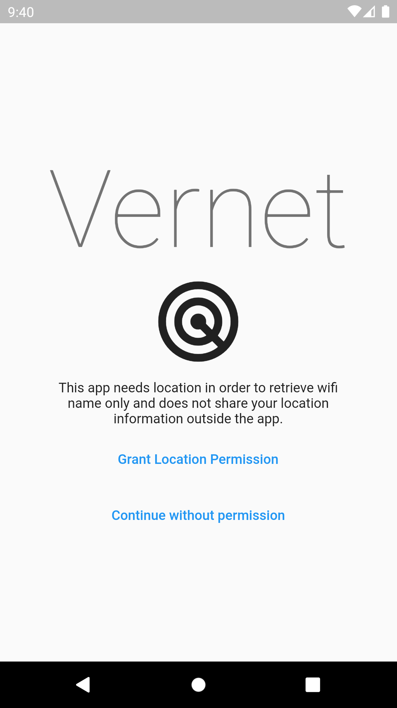
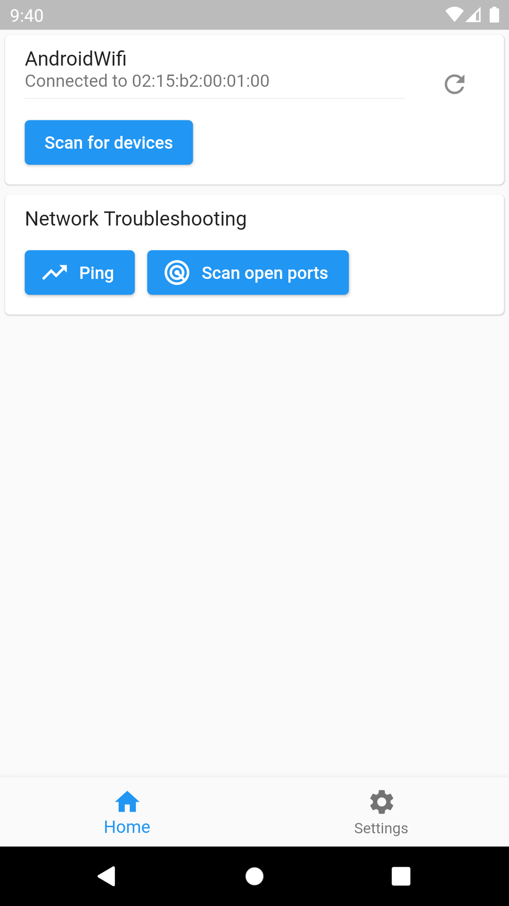
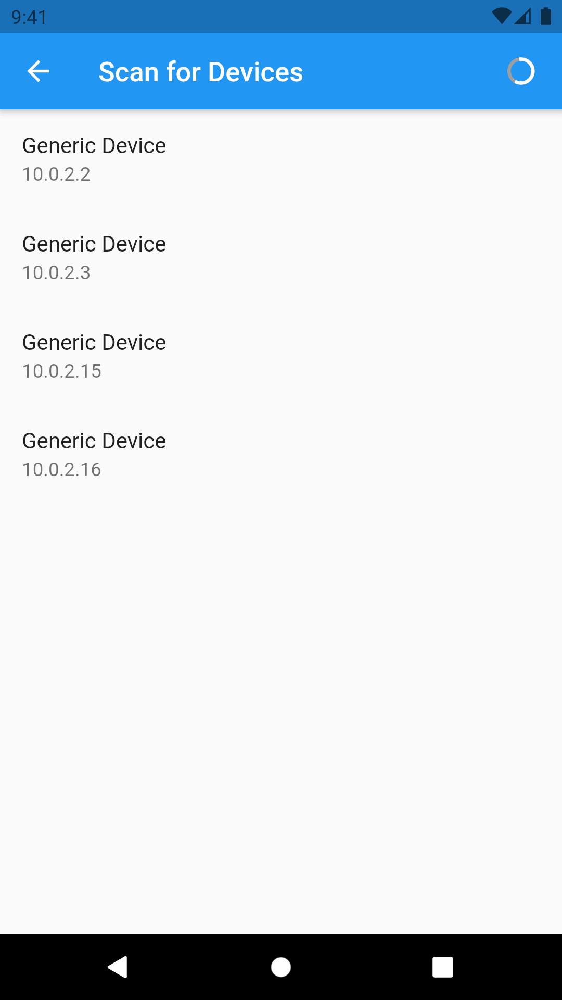
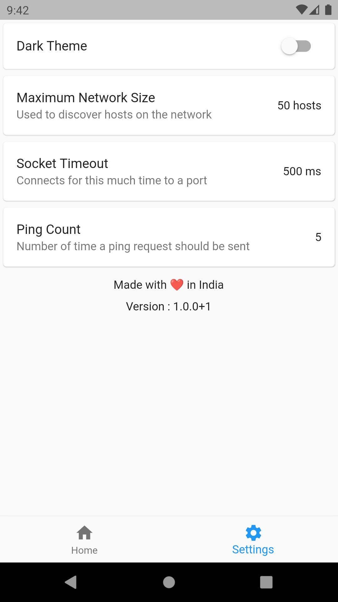
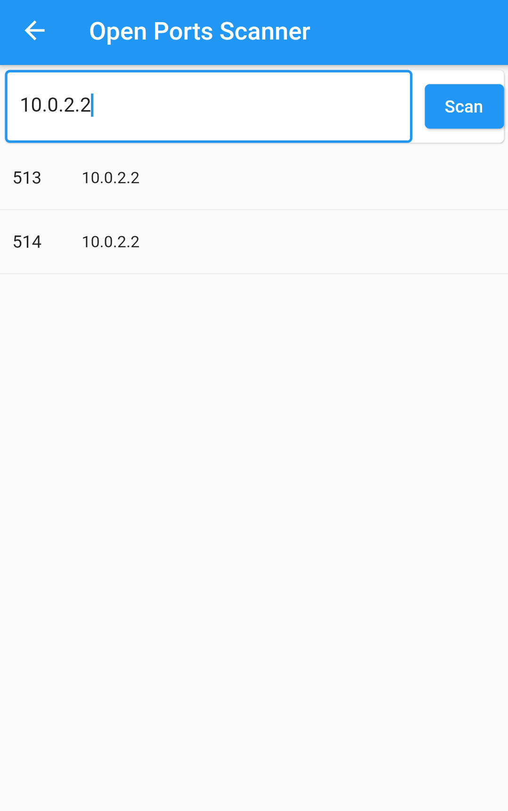
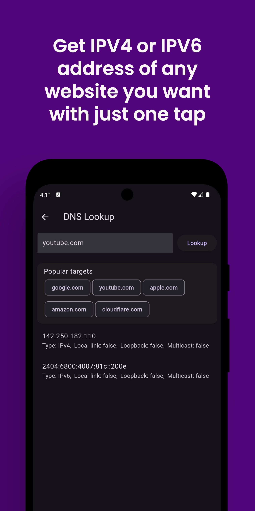
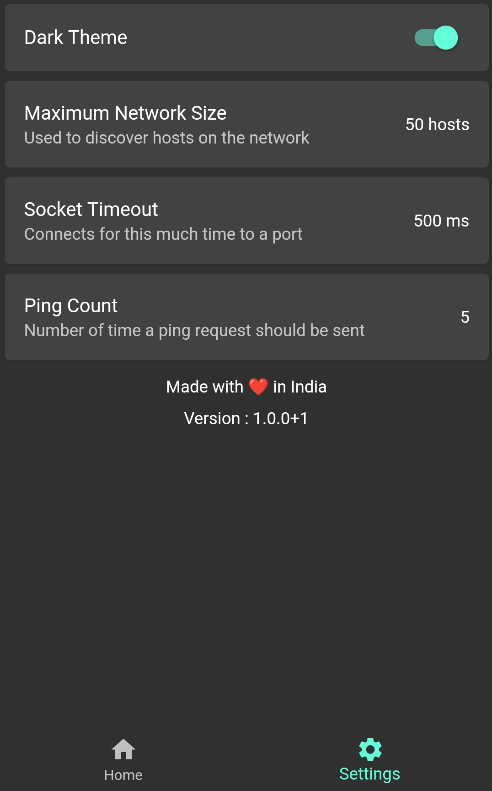
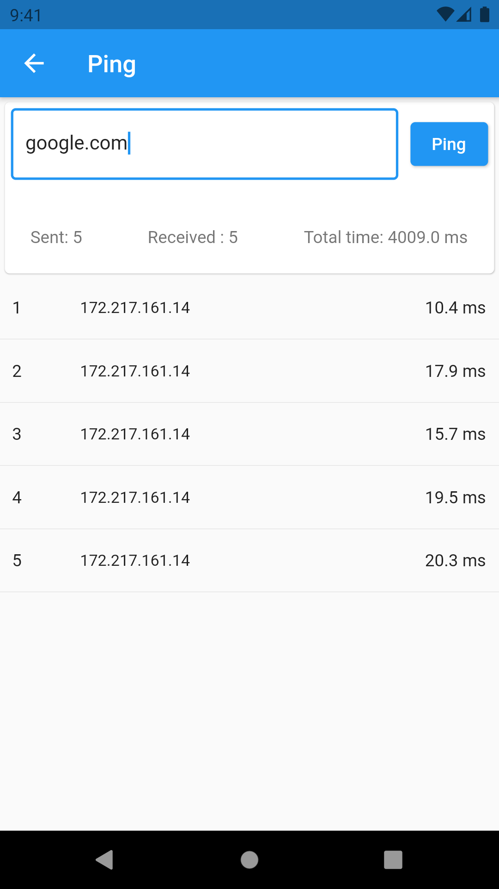

<h1>
  
  Vernet
</h1>

Vernet - Know your network


[](https://github.com/osociety/vernet/actions/workflows/flutter_pipeline.yml)

[](https://codecov.io/gh/osociety/vernet)

**Releases:**

[](https://f-droid.org/packages/org.fsociety.vernet)
[](https://github.com/osociety/vernet/releases/latest)
[](https://play.google.com/store/apps/details?id=org.fsociety.vernet.store)
[](https://snapcraft.io/vernet)

## Features

1. See your Wi-Fi name, BSSID, local address, gateway, and subnet.
2. Find devices connected to your local network, including automatic scans when the app opens, with the vendor behind each MAC address.
3. Check whether a website or device responds with ping, even without internet access.
4. Scan popular ports, a custom range, or a single port for reachable services.
5. Look up website addresses and find device names with forward and reverse DNS.
6. Test your download and upload speed.
7. Score your network's health and see the factors and tips behind the rating.
8. Control internet access, location permission, scan ranges, ping count, and timeouts.

Vernet helps you spot possible connection and security concerns. It does not
replace a professional security audit, but it gives you useful findings to
review, such as devices and services that are reachable on your network.

## Screenshots

|Vernet|Home|Connected Devices|Security Findings|
|-|-|-|-|
|||||
|Ping|DNS|Speed test|Settings|
|||||

## Download

| Android | iOS | macOS | Linux | Windows |
|-----------|-----|-------|-------|---------|
|<a href='https://f-droid.org/packages/org.fsociety.vernet'></a><a href='https://play.google.com/store/apps/details?id=org.fsociety.vernet.store'></a>| Coming soon |<a href='https://github.com/osociety/vernet/releases/latest'></a>|<a href="https://snapcraft.io/vernet"></a>|<a href="https://get.microsoft.com/installer/download/9N1170N3PHMM?referrer=appbadge" target="_self"></a>|

## Beta testing

Vernet is maintained by one person and tested on a handful of devices, so
pre-release builds reach real networks mostly through volunteers. If you are
willing to run a build that might break, you are exactly who this project
needs.

### Android

Pick either route:

| Route | What you get |
|---|---|
| [Google Play beta](https://play.google.com/apps/testing/org.fsociety.vernet.store) | Tap the link, press **Join the beta**, and update Vernet as usual. This switches your existing Play install to the beta channel, so you get new builds before anyone else. |
| [GitHub pre-release APKs](https://github.com/osociety/vernet/releases) | Download the `*-app-arm64-v8a-dev-release.apk` for a modern phone, `armeabi-v7a` for older 32-bit devices, or `x86_64` for emulators. These are the `dev` build, so they install alongside the Play version instead of replacing it. |

### Windows

Windows has the fewest testers of any platform, and the most room for things to
go quietly wrong — Wi-Fi adapter drivers, firewall prompts, and SmartScreen all
behave differently from one machine to the next.

1. Grab `Vernet-<version>-windows-x64.zip` (or `-windows-arm64.zip`, or the
   `.msixbundle`) from [releases](https://github.com/osociety/vernet/releases).
2. Extract it and run `vernet.exe`. If SmartScreen interrupts it, choose
   **More info**, then **Run anyway**.
3. Try a device scan, a ping, a port scan, and a speed test, and note anything
   that hangs, errors, or looks wrong compared to the phone app.
4. Tell us what happened in [Discussions](https://github.com/osociety/vernet/discussions/categories/q-a)
   or file an [issue](https://github.com/osociety/vernet/issues).

Linux and macOS testers use the same pre-release page, and Snap users can get
updates early with `sudo snap install vernet --beta`.

Beta testing has already turned up real bugs: release builds printing debug
logs, an empty What's New screen, an invisible Android notification icon, and
update checks offering pre-releases to stable installs. Reports like "the scan
finds nothing on my laptop" or "speed test is way off on my machine" are the
ones that get fixed.

## How to install

Vernet is available for Linux, Windows and macOS. Linux and Windows builds come in both **x64** and **arm64**.

| Platform | Architectures | Install from |
|---|---|---|
| Linux | x64, arm64 | [Snap Store](https://snapcraft.io/vernet) or [GitHub releases](https://github.com/osociety/vernet/releases/latest) |
| Windows | x64, arm64 | [Microsoft Store](https://apps.microsoft.com/detail/9N1170N3PHMM) or [GitHub releases](https://github.com/osociety/vernet/releases/latest) |
| macOS | Apple silicon and Intel | [GitHub releases](https://github.com/osociety/vernet/releases/latest) |

Not sure which architecture you have? On Linux, run `uname -m`: `x86_64` means x64 and `aarch64` means arm64. On Windows, open **Settings > System > About** and check "System type".

### Instructions for Linux

#### Option 1: Snap Store (recommended)

```bash
sudo snap install vernet --beta
```

Then connect the network permissions once, so the app can discover devices:

```bash
sudo snap connect vernet:network-observe
sudo snap connect vernet:network-manager-observe
```

`snap install` picks the right build for your architecture (x64 or arm64) automatically.

#### Option 2: Download from GitHub

1. Star this repository.
2. Install the `net-tools` package for the `arp` command, otherwise the app will not run.
   ```bash
   sudo apt install net-tools
   ```
3. Download the zip for your architecture from [releases](https://github.com/osociety/vernet/releases/latest):
   - `Vernet-<version>-linux-x64.zip` for x64
   - `Vernet-<version>-linux-arm64.zip` for arm64
4. Extract the downloaded zip file.
5. Go to the `bundle` folder and double click the `vernet` file.

### Instructions for Windows

#### Option 1: Microsoft Store (recommended)

Install Vernet from the [Microsoft Store](https://apps.microsoft.com/detail/9N1170N3PHMM). The Store installs the right build for your device (x64 or arm64) and keeps it updated.

#### Option 2: Download from GitHub

1. Star this repository.
2. Download the zip for your architecture from [releases](https://github.com/osociety/vernet/releases/latest):
   - `Vernet-<version>-windows-x64.zip` for x64
   - `Vernet-<version>-windows-arm64.zip` for arm64
3. Extract the downloaded zip file.
4. Run `vernet.exe`.
5. Click on **More info**, then tap **Run anyway**.
6. Give permission if asked.

### Instructions for macOS

Note: the macOS build hasn't been notarized yet.

1. Star this repository.
2. Download `Vernet-<version>-macos.zip` (or the `.dmg`) from [releases](https://github.com/osociety/vernet/releases/latest).
3. Extract the downloaded zip file, or open the `.dmg`.
4. Copy the app to the Applications folder.
5. Go to the Applications folder.
6. Hold down Cmd and click on Vernet.
7. In the context menu, click **Open**.

## Publishing to F-Droid
You can follow this guide to publish your app to f-droid - https://op3nsoc13ty.blogspot.com/2021/06/publish-your-first-flutter-app-to-fdroid.html

## How to Contribute

1. Found bug? Open an [issue](https://github.com/osociety/vernet/issues)
2. Do you know Flutter? Fix bugs and open a [Pull Request](https://github.com/osociety/vernet/pulls)
3. Don't write code? Run a [beta build](#beta-testing) and report what breaks — that is the most useful contribution of all, and it needs one device you already own.

## Community

[GitHub Discussions](https://github.com/osociety/vernet/discussions) is where
Vernet gets discussed, and it is fine to just say hi. Nothing is gated, no
template is required, and questions get answered — pick the shelf that fits:

| Category | What goes there |
|---|---|
| [Announcements](https://github.com/osociety/vernet/discussions/categories/announcements) | Each new release, with what changed |
| [Q&A](https://github.com/osociety/vernet/discussions/categories/q-a) | "Why doesn't the scan find my printer?" and other help |
| [General](https://github.com/osociety/vernet/discussions/categories/general) | Anything about Vernet, networking, or your setup |
| [Ideas](https://github.com/osociety/vernet/discussions/categories/ideas) | Features you want built |
| [Show and tell](https://github.com/osociety/vernet/discussions/categories/show-and-tell) | Interesting things you found on your network |
| [Polls](https://github.com/osociety/vernet/discussions/categories/polls) | Vote on what to work on next |

Watching the repository (**Watch → Discussions**) means a new release shows up
as a notification, and beta builds are announced there first.

## Support and Donate

1. Support this project by becoming stargazer of this project.
2. Rate our app on [Google Play](https://play.google.com/store/apps/details?id=org.fsociety.vernet.store)

3. Buy me a coffee.

    [](https://liberapay.com/OpenSociety/donate)

4. Support me on Ko-Fi

    [](https://ko-fi.com/fs0c13ty)

*Vernet is an independent open-source project, licensed under Apache-2.0, and is not affiliated with or endorsed by any other organization or product with a similar name.*

