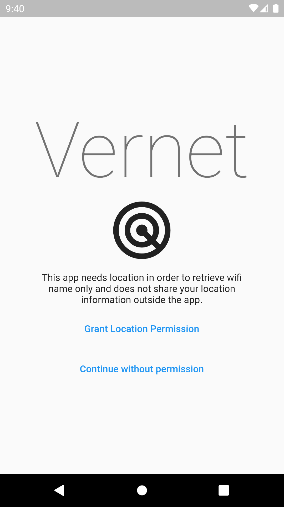
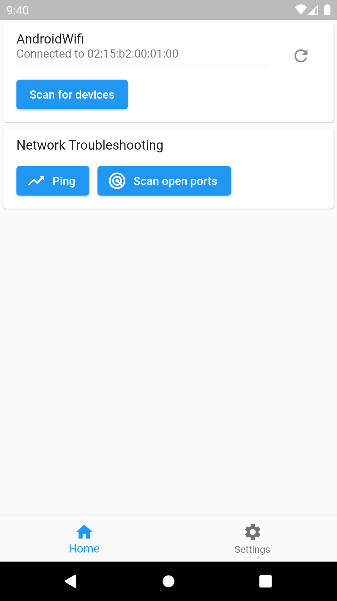
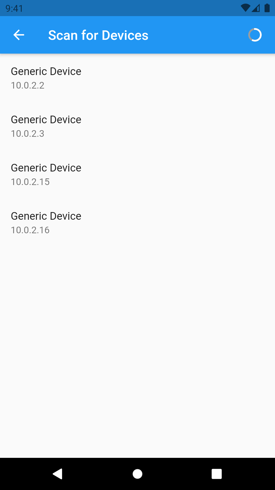
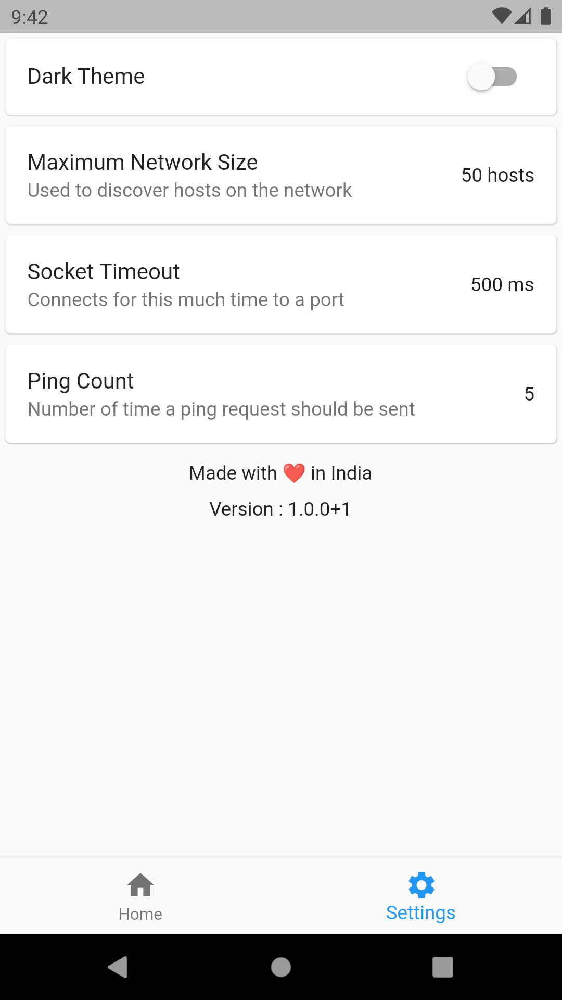
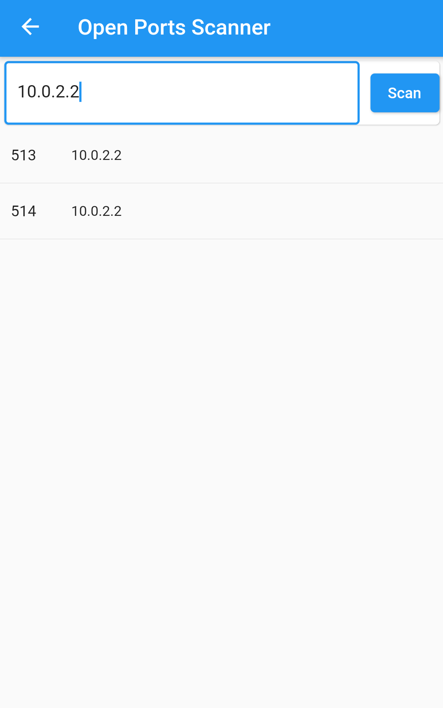
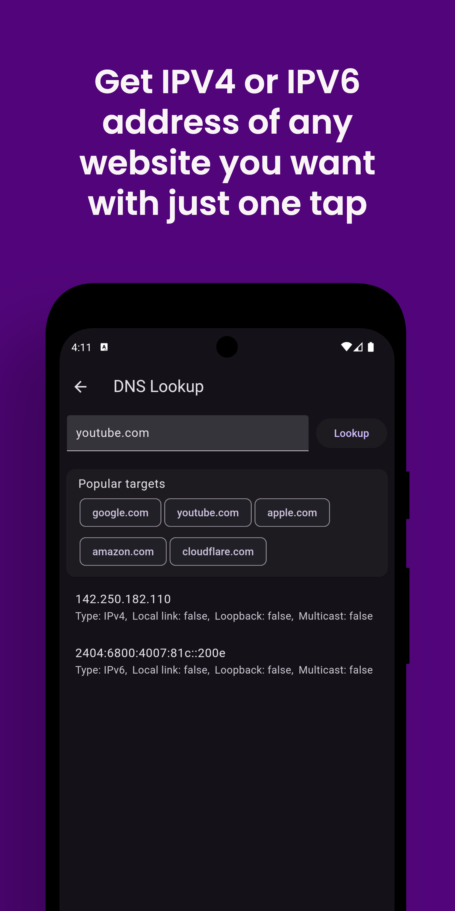
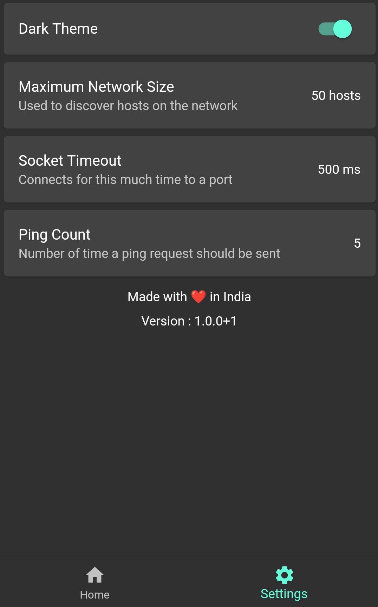
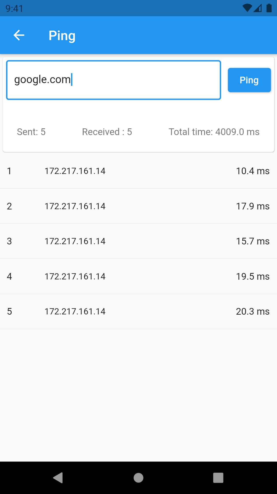

<h1>
  
  Vernet
</h1>

Vernet - Know your network

## Download

| Android | iOS | macOS | Linux | Windows |
|-----------|-----|-------|-------|---------|
|| Coming soon ||||

The Google Play build contains ads. The F-Droid and GitHub builds are ad-free.

## Features

1. See your Wi-Fi name, BSSID, local address, gateway, and subnet.
2. Find devices connected to your local network, including automatic scans when the app opens, with the vendor behind each MAC address.
3. Check whether a website or device responds with ping, even without internet access.
4. Scan popular ports, a custom range, or a single port for reachable services.
5. Look up website addresses and find device names with forward and reverse DNS.
6. Test your download and upload speed.
7. Score your network's health and see the factors and tips behind the rating.
8. Control internet access, location permission, scan ranges, ping count, and timeouts.

Vernet helps you spot possible connection and security concerns. It does not
replace a professional security audit, but it gives you useful findings to
review, such as devices and services that are reachable on your network.

## Screenshots

|Vernet|Home|Connected Devices|Security Findings|
|-|-|-|-|
|||||
|Ping|DNS|Speed test|Settings|
|||||

## Documentation

| Guide | Covers |
|---|---|
| [Install on desktop](docs/INSTALL.md) | Snap, Microsoft Store, and manual downloads for Linux, Windows and macOS, with the `net-tools` and `libsqlite3.so` gotchas and the optional `avahi-observe` connection. |
| [Beta testing](docs/BETA_TESTING.md) | How to run pre-release builds on each platform and what to report. |
| [Android build flavors](docs/BUILD_FLAVORS.md) | Why `dev`, `fdroid` and `store` behave differently, and the `store_overlay/` rule. |
| [Community](docs/COMMUNITY.md) | Which GitHub Discussions category to post in. |
| [Contributing](CONTRIBUTING.md) | Setting up a development checkout and opening a pull request. |
| [Architecture](ARCHITECTURE.md) | How `lib/` is layered and where new code belongs. |

## Current Milestone

   

Counts include pull requests tagged to the milestone, not only its issues.

## How to Contribute

1. Found bug? Open an [issue](https://github.com/osociety/vernet/issues)
2. Do you know Flutter? Fix bugs and open a [Pull Request](https://github.com/osociety/vernet/pulls)
3. Don't write code? Run a [beta build](docs/BETA_TESTING.md) and report what breaks — that is the most useful contribution of all, and it needs one device you already own.

## Support and Donate

1. Support this project by becoming stargazer of this project.
2. Rate our app on [Google Play](https://play.google.com/store/apps/details?id=org.fsociety.vernet.store)

3. Buy me a coffee.

    

4. Support me on Ko-Fi

    

*Vernet is an independent open-source project, licensed under Apache-2.0, and is not affiliated with or endorsed by any other organization or product with a similar name.*
