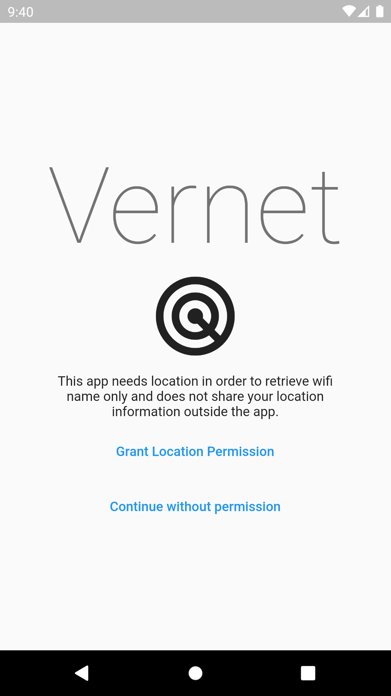
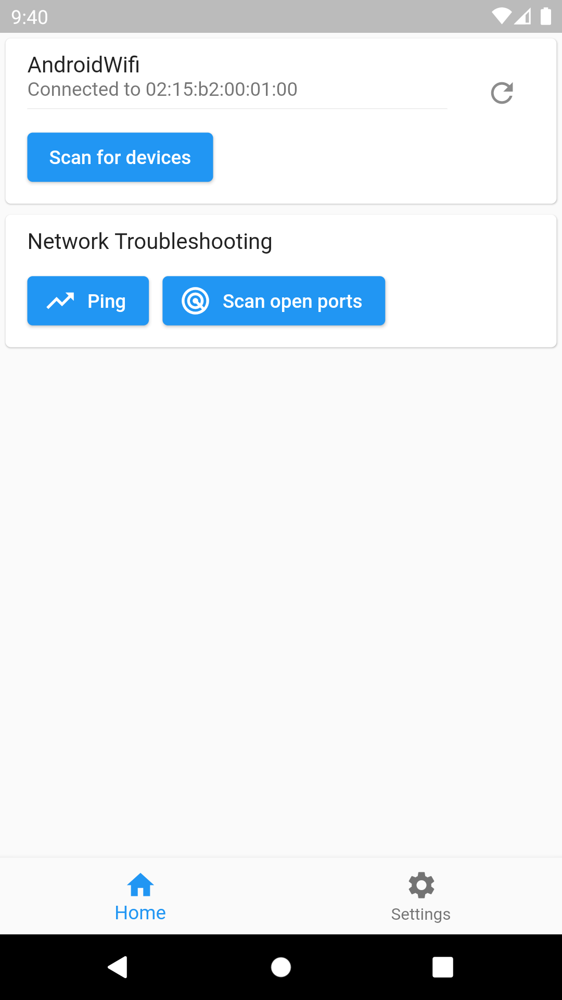
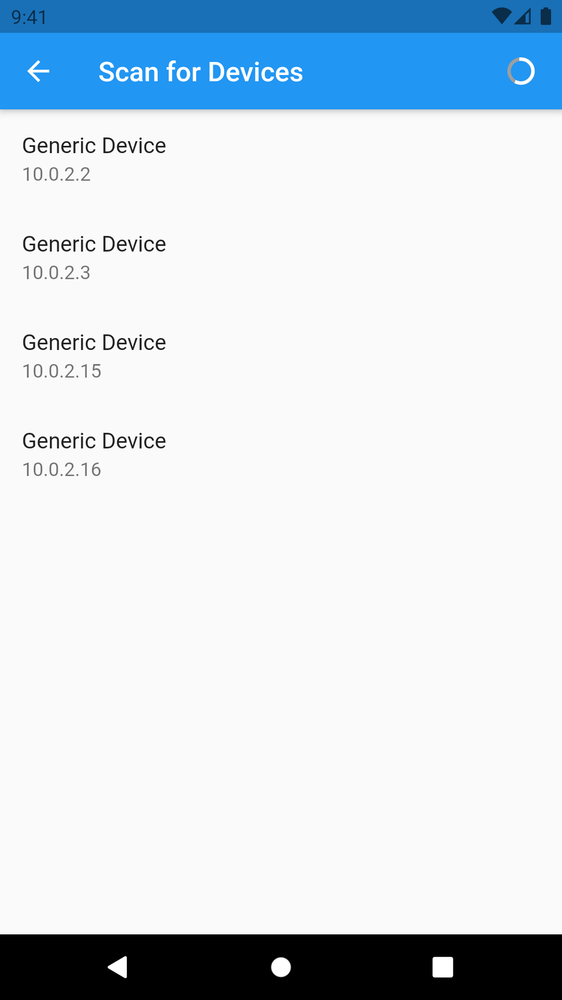
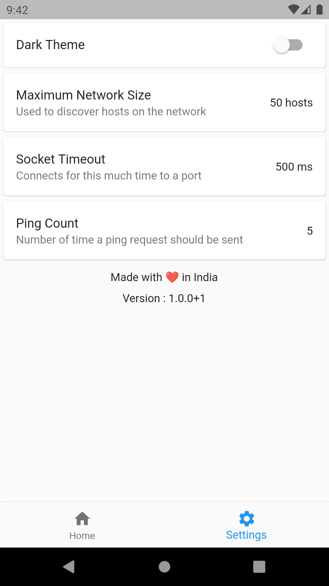
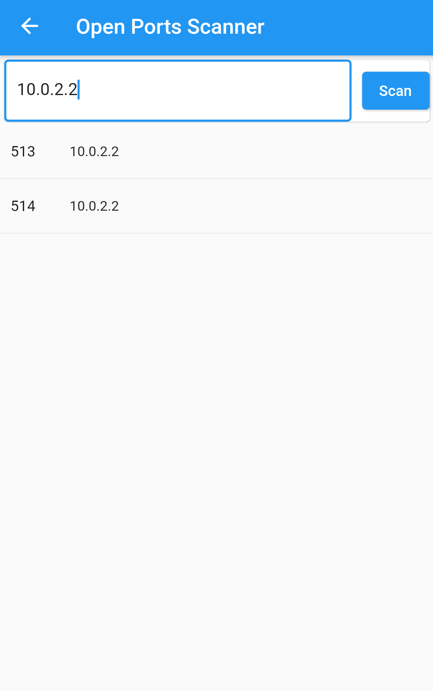
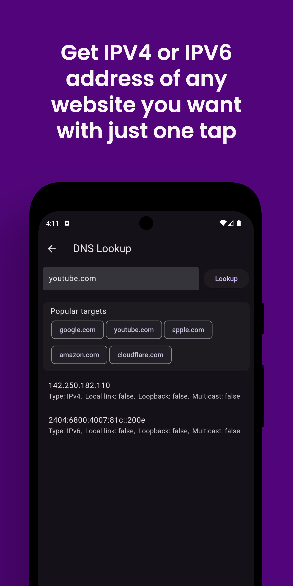
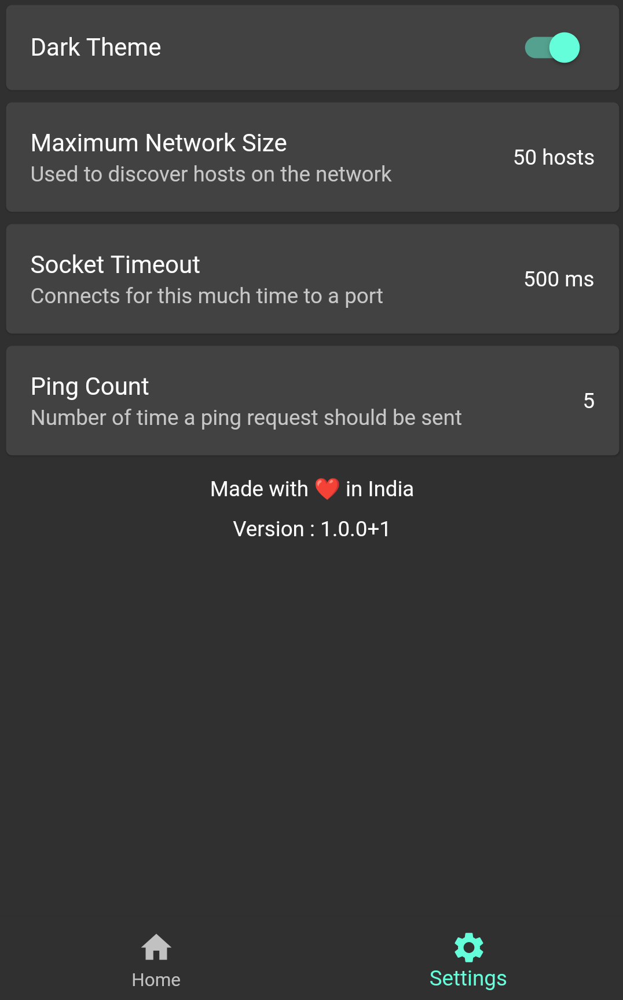
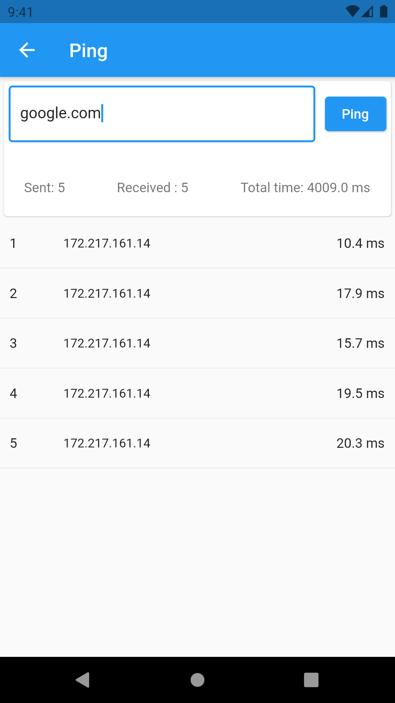

<h1>
  
  Vernet
</h1>

Vernet - Know your network

[](https://f-droid.org/packages/org.fsociety.vernet)
[](https://github.com/osociety/vernet/releases/latest)


[](https://codecov.io/gh/osociety/vernet)

## Features

1. See your Wi-Fi name, BSSID, local address, gateway, and subnet.
2. Find devices connected to your local network, including automatic scans when the app opens.
3. Check whether a website or device responds with ping, even without internet access.
4. Scan popular ports, a custom range, or a single port for reachable services.
5. Look up website addresses and find device names with forward and reverse DNS.
6. Test your download and upload speed.
7. View your public IP and internet provider information.
8. Control internet access, location permission, scan ranges, ping count, and timeouts.

Vernet helps you spot possible connection and security concerns. It does not
replace a professional security audit, but it gives you useful findings to
review, such as devices and services that are reachable on your network.

## Screenshots

|Vernet|Home|Connected Devices|Security Findings|
|-|-|-|-|
|||||
|Ping|DNS|Speed test|Settings|
|||||

## Download

| Android | iOS | macOS | Linux | Windows |
|-----------|-----|-------|-------|---------|
|<a href='https://f-droid.org/packages/org.fsociety.vernet'></a><a href='https://play.google.com/store/apps/details?id=org.fsociety.vernet.store'></a>| Coming soon |<a href='https://github.com/osociety/vernet/releases/latest'></a>|<a href="https://snapcraft.io/vernet"></a>|<a href="https://get.microsoft.com/installer/download/9N1170N3PHMM?referrer=appbadge" target="_self"></a>|

Web is not currently supported.

## How to install

Vernet is available for Linux, Windows and macOS. Linux and Windows builds come in both **x64** and **arm64**.

| Platform | Architectures | Install from |
|---|---|---|
| Linux | x64, arm64 | [Snap Store](https://snapcraft.io/vernet) or [GitHub releases](https://github.com/osociety/vernet/releases/latest) |
| Windows | x64, arm64 | [Microsoft Store](https://apps.microsoft.com/detail/9N1170N3PHMM) or [GitHub releases](https://github.com/osociety/vernet/releases/latest) |
| macOS | Apple silicon and Intel | [GitHub releases](https://github.com/osociety/vernet/releases/latest) |

Not sure which architecture you have? On Linux, run `uname -m`: `x86_64` means x64 and `aarch64` means arm64. On Windows, open **Settings > System > About** and check "System type".

### Instructions for Linux

#### Option 1: Snap Store (recommended)

```bash
sudo snap install vernet --beta
```

Then connect the network permissions once, so the app can discover devices:

```bash
sudo snap connect vernet:network-observe
sudo snap connect vernet:network-manager-observe
```

`snap install` picks the right build for your architecture (x64 or arm64) automatically.

#### Option 2: Download from GitHub

1. Star this repository.
2. Install the `net-tools` package for the `arp` command, otherwise the app will not run.
   ```bash
   sudo apt install net-tools
   ```
3. Download the zip for your architecture from [releases](https://github.com/osociety/vernet/releases/latest):
   - `Vernet-<version>-linux-x64.zip` for x64
   - `Vernet-<version>-linux-arm64.zip` for arm64
4. Extract the downloaded zip file.
5. Go to the `bundle` folder and double click the `vernet` file.

### Instructions for Windows

#### Option 1: Microsoft Store (recommended)

Install Vernet from the [Microsoft Store](https://apps.microsoft.com/detail/<your-product-id>). The Store installs the right build for your device (x64 or arm64) and keeps it updated.

#### Option 2: Download from GitHub

1. Star this repository.
2. Download the zip for your architecture from [releases](https://github.com/osociety/vernet/releases/latest):
   - `Vernet-<version>-windows-x64.zip` for x64
   - `Vernet-<version>-windows-arm64.zip` for arm64
3. Extract the downloaded zip file.
4. Run `vernet.exe`.
5. Click on **More info**, then tap **Run anyway**.
6. Give permission if asked.

### Instructions for macOS

Note: the macOS build hasn't been notarized yet.

1. Star this repository.
2. Download `Vernet-<version>-macos.zip` (or the `.dmg`) from [releases](https://github.com/osociety/vernet/releases/latest).
3. Extract the downloaded zip file, or open the `.dmg`.
4. Copy the app to the Applications folder.
5. Go to the Applications folder.
6. Hold down Cmd and click on Vernet.
7. In the context menu, click **Open**.

## Publishing to F-Droid
You can follow this guide to publish your app to f-droid - https://op3nsoc13ty.blogspot.com/2021/06/publish-your-first-flutter-app-to-fdroid.html

## How to Contribute

1. Found bug? Open an [issue](https://github.com/osociety/vernet/issues)
2. Do you know Flutter? Fix bugs and open a [Pull Request](https://github.com/osociety/vernet/pulls)

## Support and Donate

1. Support this project by becoming stargazer of this project.
2. Rate our app on [Google Play](https://play.google.com/store/apps/details?id=org.fsociety.vernet.store)

3. Buy me a coffee.

    | Librepay | 
    |----------|
    |[](https://liberapay.com/OpenSociety/donate)

4. Support me on Ko-Fi

    [](https://ko-fi.com/fs0c13ty)

*Vernet is an independent open-source project, licensed under Apache-2.0, and is not affiliated with or endorsed by any other organization or product with a similar name.*

